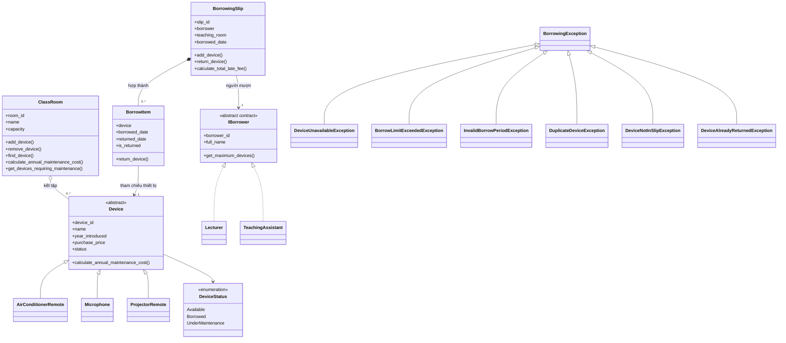

# Giai đoạn 01 – Phân tích yêu cầu nghiệp vụ và thiết kế sơ bộ

## 1. Mô tả bài toán

Theo tài liệu `lab w06.pdf`, trường đại học cần một chương trình quản lý thiết bị phục vụ học tập và giảng dạy. Ba loại thiết bị ban đầu là điều khiển điều hòa, micro và điều khiển máy chiếu. Hệ thống cần quản lý thiết bị, phòng học, người mượn, phiếu mượn và quá trình trả thiết bị.

Một phiếu mượn thuộc về một người mượn và có thể chứa nhiều thiết bị. Khi mượn hoặc trả, chương trình phải kiểm tra các điều kiện nghiệp vụ. Những tình huống không hợp lệ phải được thông báo bằng ngoại lệ. Nếu thao tác thất bại, trạng thái thiết bị và phiếu mượn phải giữ nhất quán.

Bài sẽ được triển khai bằng Python. Các khái niệm OOP trong đề được thể hiện bằng các cơ chế tương ứng của Python, nhưng yêu cầu nghiệp vụ không thay đổi.

## 2. Các đối tượng nghiệp vụ

- **Thiết bị:** có mã, tên, năm đưa vào sử dụng, giá mua và trạng thái hoạt động; cung cấp cách tính chi phí bảo trì dự kiến trong một năm.
- **Phòng học:** có mã phòng, tên phòng, sức chứa và danh sách thiết bị.
- **Người mượn:** gồm giảng viên và trợ giảng, mỗi loại có giới hạn số thiết bị được mượn trên một phiếu.
- **Phiếu mượn:** gắn với một người mượn, phòng dạy và ngày mượn; quản lý nhiều mục mượn.
- **Mục mượn (`BorrowItem`):** tham chiếu đến một thiết bị và ghi nhận thời gian mượn/trả.
- **Ngoại lệ nghiệp vụ:** biểu diễn các trường hợp thao tác không hợp lệ.

## 3. Yêu cầu chức năng

1. Quản lý ba loại thiết bị được nêu trong đề.
2. Kiểm tra mã thiết bị không rỗng, giá mua lớn hơn 0 và năm đưa vào sử dụng không lớn hơn năm hiện tại.
3. Quản lý thiết bị trong phòng; không thêm thiết bị `None` hoặc thiết bị trùng mã trong cùng phòng.
4. Tính chi phí bảo trì năm của phòng bằng đa hình, không kiểm tra từng loại thiết bị bằng chuỗi `if`/`switch`.
5. Liệt kê thiết bị đang ở trạng thái `UnderMaintenance` hoặc có thời gian sử dụng trên 5 năm.
6. Phân biệt người mượn là giảng viên hoặc trợ giảng, với giới hạn lần lượt là 3 và 2 thiết bị trên một phiếu.
7. Thêm thiết bị vào phiếu sau khi kiểm tra các điều kiện mượn.
8. Trả thiết bị hợp lệ, ghi nhận ngày trả và chuyển thiết bị về trạng thái sẵn sàng.
9. Tính phí trả muộn và hỗ trợ các tình huống hiển thị trong đề.
10. Phát sinh ngoại lệ nghiệp vụ khi điều kiện mượn/trả không hợp lệ.

## 4. Quy tắc nghiệp vụ

### 4.1. Thêm thiết bị vào phiếu

Trước khi thay đổi dữ liệu, cần kiểm tra:

1. Thiết bị không phải `None`.
2. Số ngày mượn lớn hơn 0.
3. Thiết bị chưa có trong phiếu.
4. Người mượn chưa đạt giới hạn thiết bị.
5. Thiết bị đang ở trạng thái `Available`.
6. Thời hạn mượn không vượt giới hạn của thiết bị, nếu giới hạn này được xác định khi triển khai.

Sau khi kiểm tra hợp lệ, chương trình mới tạo mục mượn, chuyển trạng thái thiết bị sang `Borrowed` và thêm mục vào phiếu. Nếu kiểm tra thất bại, không được để lại thay đổi dở dang.

### 4.2. Trả thiết bị

1. Tìm mục mượn theo mã thiết bị.
2. Nếu không có trong phiếu, phát sinh `DeviceNotInSlipException`.
3. Nếu đã trả trước đó, phát sinh `DeviceAlreadyReturnedException`.
4. Ngày trả không được trước ngày mượn.
5. Khi hợp lệ, ghi nhận ngày trả và chuyển thiết bị về trạng thái `Available`.

## 5. Danh sách lớp dự kiến

| Lớp/kiểu | Trách nhiệm | Quan hệ |
|---|---|---|
| `DeviceStatus` | Các trạng thái thiết bị | Được dùng trong `Device` |
| `Device` | Lớp cơ sở trừu tượng, chứa dữ liệu chung và khai báo phương thức tính chi phí bảo trì | Lớp cha của các loại thiết bị |
| `AirConditionerRemote` | Điều khiển điều hòa | Kế thừa `Device` |
| `Microphone` | Micro | Kế thừa `Device` |
| `ProjectorRemote` | Điều khiển máy chiếu | Kế thừa `Device` |
| `ClassRoom` | Quản lý thông tin phòng và danh sách thiết bị | Kết tập các `Device` |
| `IBorrower` | Quy định thông tin và giới hạn mượn | Được hai loại người mượn thực hiện theo giao ước |
| `Lecturer` | Giảng viên, giới hạn 3 thiết bị | Tuân theo `IBorrower` |
| `TeachingAssistant` | Trợ giảng, giới hạn 2 thiết bị | Tuân theo `IBorrower` |
| `BorrowItem` | Ghi nhận một thiết bị trong phiếu | Tham chiếu đến `Device` |
| `BorrowingSlip` | Quản lý phiếu và các mục mượn | Hợp thành các `BorrowItem`, tham chiếu người mượn |
| `BorrowingException` | Ngoại lệ nghiệp vụ cơ sở | Kế thừa ngoại lệ chuẩn của Python |
| Các ngoại lệ dẫn xuất | Thể hiện từng lỗi nghiệp vụ | Kế thừa `BorrowingException` |
| `main.py` hoặc `Program` tương đương | Chạy các tình huống thử | Sử dụng các lớp nghiệp vụ |

### Ghi chú về interface trong Python

Python không có từ khóa `interface` giống C#. Có thể thể hiện giao ước của `IBorrower` bằng lớp trừu tượng sử dụng `abc.ABC` và `@abstractmethod`, hoặc bằng `typing.Protocol`. Để bài dễ theo dõi với người mới học OOP, dự kiến dùng lớp trừu tượng; quyết định này sẽ được thể hiện khi viết code.

## 6. Sơ đồ quan hệ lớp ban đầu

Đây là sơ đồ khái niệm ban đầu. Ký hiệu và tên phương thức trong sơ đồ mô tả quan hệ dự kiến, chưa phải chữ ký Python cuối cùng.
